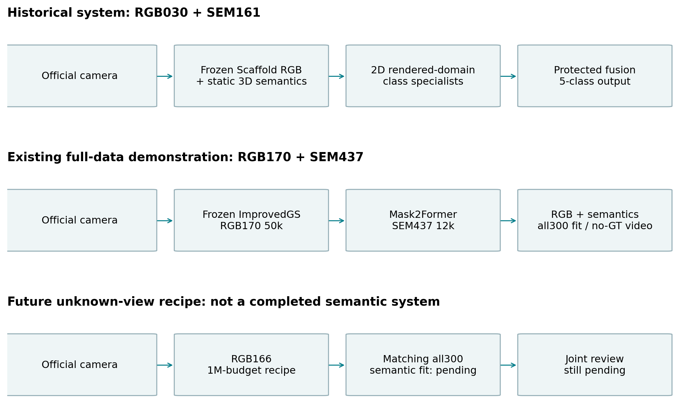
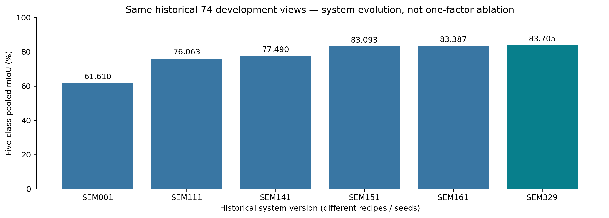

# IC-SHM 2026 · 桥梁新视角 RGB 与语义重建

本仓库公开我们在 IC-SHM 2026 Project 2 中的研究代码、开发经历、实验成绩与论文素材，供组员共同理解、核对和写作。**科学结果截止2026-09-23，公开整理日期2026-09-29。**

[在线可视化与视频](https://samtu648-hub.github.io/icshm2026-semantic-gs/) · [作者必读](docs/paper/author_guide.md) · [完整素材下载](https://github.com/samtu648-hub/icshm2026-semantic-gs/releases/tag/paper-handoff-20260929-v1) · [两方案对照](docs/paper/team_comparison.md)

## 从哪里开始

- **理解项目**：先读[12章作者必读](docs/paper/author_guide.md)，再读[开发历程](docs/paper/development_history.md)。解释任务、训练与推理、路线转向、失败与局限。
- **查阅实验**：看[结果表](docs/paper/results_summary.md)、[实验登记](experiments/registry.yaml)与[在线实验索引](https://samtu648-hub.github.io/icshm2026-semantic-gs/#experiments)。351条历史登记包含训练、诊断、失败、阻塞和计划，不等于351次已完成实验。
- **查看效果**：在线页面提供10组图和6类8段视频；[中英图注](docs/paper/captions.md)链接原图与下载素材。
- **运行代码**：先看[环境与复现边界](docs/public_reproduction.md)。阅读文档无需安装训练环境；源码公开不意味着附带全部数据、模型或每条历史实验环境。

## 项目解决什么问题

给定官方相机参数，输出该视角的RGB图像与对齐的五类语义图：`0 background`、`1 deck`、`2 stay_cable`、`3 tower`、`4 foundation`。发布数据有400张照片，其中300张带标签。外部相机推理不读取目标视角的真实照片或GT。

已有全量展示系统为：

```text
官方相机（位姿、内参、尺寸）
              ↓
冻结 RGB170：ImprovedGS 50k RGB 渲染
              ↓
SEM437：匹配渲染域的 Mask2Former-Swin-L
              ↓
RGB 图像 + 五类逐像素语义图
```



## 当前模型身份

- **RGB170＋SEM437**：已有全400 RGB／全300语义训练与展示。SEM437的95.678649%为全300五类mIoU训练拟合。
- **RGB166**：ADR-175推荐的未来未知视角100万预算RGB配方对应全量模型；匹配最终语义尚未训练，不能写成已完成最终系统。
- **RGB030＋SEM161**：历史冻结RGB＋三维语义＋二维类别专家的完整链，保留为历史复现与工程回退。它不是SEM437内部仍使用的模块。
- **RGB175／RGB176**：容量空间确认的配对模型；全量RGB166／RGB170不能替代这组留出对照。

详见[作者必读的方法章](docs/paper/author_guide.md)、[当前状态](PROJECT_STATUS.md)及[ADR-175](DECISIONS.md)。

## 关键结果与证据角色

- **历史74图开发演进**：SEM001→SEM161，五类mIoU由61.610304%到83.387017%，提高21.776713个百分点。该结果描述多阶段系统演进，不是一次单变量消融。
- **强二维完整系统比较**：SEM350同74图中，Mask2Former raw为86.513086%；RGB底座及训练预算差异、6张退化视角均保留。
- **空间开发确认**：AbsGS相对Standard，两个语义seed平均前景mIoU优势在v1为20.139420pp、v2为0.420671pp。幅度与区域差异明显；RGB仅seed0，fold有历史开发暴露。
- **容量反例**：QUAL026严格配对中，150万相对100万预算在353训练图PSNR仅+0.016242dB，30张holdout却−0.867008dB，26张下降。
- **未解决问题**：357视角桥面漏检、细索缺口与水面伪影仍存在。100张无语义GT图和144帧轨迹用于定性展示。



[完整结果与来源](docs/paper/results_summary.md) · [跨fold／seed图](https://samtu648-hub.github.io/icshm2026-semantic-gs/#F07) · [容量反例](https://samtu648-hub.github.io/icshm2026-semantic-gs/#F09) · [失败图](https://samtu648-hub.github.io/icshm2026-semantic-gs/#F10)

历史74、OOF、空间确认、全量拟合和无GT展示分别解释。不得把61.61%和95.68%相减作为泛化提升，也不据无GT视频宣称准确率改善。

## 与组员方案共同写作

组员维护[SHM26P2 / Bridge-RGS](https://github.com/QinnyuLan/SHM26P2)。[两方案对照说明](docs/paper/team_comparison.md)按实际方法、数据角色、推理依赖和证据边界连接两条路线。共同写作不代表已完成模型融合或统一协议的新对比实验。

## 代码、材料与出处

`src/`包含算法实现，`scripts/`包含训练、评价、诊断和材料构建入口，`tests/`验证实现契约，`experiments/`保存配置、划分与原实验报告；`reproduction/`保留历史SEM161复现入口，`third_party/README.md`记录上游版本及许可。

本公开仓库从当前研究工作区导出，采用独立的新Git历史。原实验commit、配置、seed与指标继续按历史记录保存；它们不是本仓库首次公开提交的commit。逐文件出处与加工记录见发布来源清单（来源记录：`publication/source_manifest.json`；未随公开包提供）。

原始数据集、标签、权重、完整运行产物及第三方整仓不随源码上传。经确认可公开的精选媒体通过Release与在线页面提供。第三方许可分别适用；本次公开不为全部代码、数据或权重统一授予新的开源许可，见[版权与来源](NOTICE.md)。

问题与讨论可在本仓库Issues中按实验ID、图号或文档章节提出。正式论文底稿与贡献归属由团队共同定稿。
