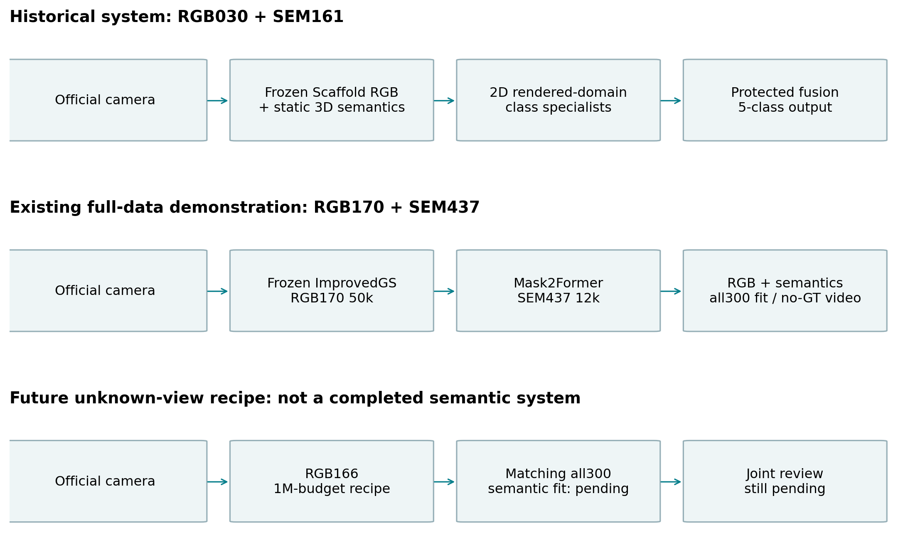
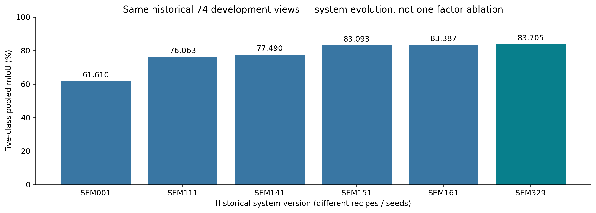
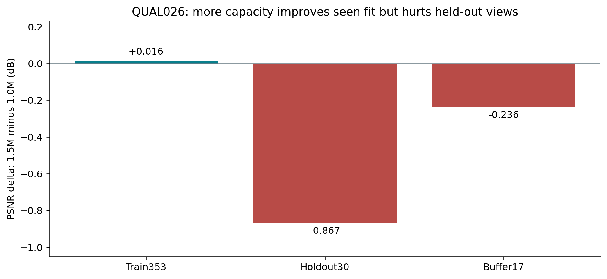
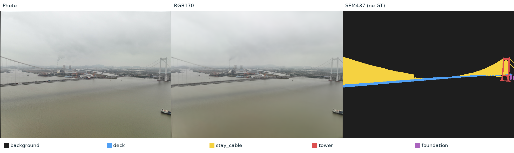

# 作者必读：理解项目之后再写论文

伙伴交接版 · 证据截止 2026-09-23 · 整理 2026-09-29

面向没有全程参与开发、但负责组织论文论点和实验的组员。读完后应能独立解释任务、画出实际系统、说明关键转向、选择恰当证据，并回答失败与局限。本文是项目理解文档；可改写的论文段落另见 paper_notes.md。

[材料包首页](https://samtu648-hub.github.io/icshm2026-semantic-gs/index.html) · [论文底稿](paper_notes.md) · [完整历程](development_history.md)

## 三遍阅读路线

### 第一遍：建立完整认识

顺读 A01—A04，明确输入输出、数据角色、实际训练与推理流程；对照 F01、F02 和 V04。先用自己的话解释系统，再看具体分数。

### 第二遍：理解选择是怎样形成的

读 A05—A09，并按链接看 F03—F09 和开发历程。重点回答每次转向的原问题、实际对照、观察和停止理由；需要实现细节时再打开报告与配置。

### 第三遍：把认识变成可写的论点

读 A10—A12，检查 F10 失败图，完成各章自测。然后使用论文底稿、结果表和图注；遇到不清楚的结论，用实验 ID 回查，而不是从图像观感补出原因。

## A01 · 我们到底要解决什么问题

**本章问题：** 给定一个相机，系统应交付什么？

任务是在给定桥梁场景和官方相机坐标的条件下，为指定视角生成 RGB 图像及与其对齐的五类逐像素语义图。RGB回答这个视角看起来怎样；语义回答每个像素属于背景、桥面、拉索、桥塔还是基础。方法需要兼顾可渲染的场景表示和细结构识别。

训练阶段可以使用已发布照片及允许使用的标签；对外部新相机推理时，系统接收相机内参、位姿和尺寸，不能读取该目标视角的真实照片或标签。对比图中并排展示的 Photo 和 GT 是解释与评价参照，不能画成推理必需输入。

这里的语义输出是二维像素类别。后期方案的三维 Gaussian 负责生成 RGB，二维网络负责语义；它并没有证明每个 Gaussian 获得唯一的物理构件身份，也没有交付经过真值验证的完整三维语义表面。这一点决定了论文方法图和任务名称应怎样写。

本项目研究和开发都围绕一个已发布桥梁场景展开。对该场景的新视角表现，与对另一座桥、另一种采集条件的跨场景泛化，是不同问题；现有实验不能代替后者。

**配合查看：** [F02 三条系统角色，避免画成一条混合链](https://samtu648-hub.github.io/icshm2026-semantic-gs/index.html#F02) · [V04 已有展示 RGB170 + SEM437 · 144帧](https://samtu648-hub.github.io/icshm2026-semantic-gs/index.html#V04)

**原始证据：** [SUBMIT-030](../../experiments/runs/SUBMIT-030-SEM161-BUNDLE/report.md) · [SUBMIT-040](../../experiments/runs/SUBMIT-040-CLEAN-UBUNTU-REPRO/report.md) · [SEM-437](../../experiments/runs/SEM-437-RGB170-MASK2FORMER-CONTEXT50-LONG12K-ALL300/report.md)

**应掌握的结论：** 先讲清相机到 RGB／语义的任务，再解释选择了怎样的表示和分割器。

**自测：** 组员画推理图时，把真实照片放进 Mask2Former 前面是否正确？

**参考回答：** 对当前外部相机路径不正确。输入是冻结重建模型渲染的 RGB；真实照片可用于训练、对照或单独登记的照片域实验，不能当作未知目标视角的已知输入。

## A02 · 先分清数据的身份，才能读懂所有分数

**本章问题：** 400、300、74、100 和 144 各自代表什么？

发布数据有400张 RGB 照片，其中300张有语义标注。正式类别为0 background、1 deck、2 stay_cable、3 tower、4 foundation。这里的基础类 foundation 与桥塔 tower 分开；Class ID 2始终写作 stay_cable。评价标签网格为1320×989，渲染、畸变处理与标签必须保持同一像素对应。

早期语义开发采用219张训练、74张开发、7张保护视角的划分。这是语义标签的划分，不能自动推断这些视角在 RGB 重建中也被排除。74图后来被明确复用，适合回顾历史系统演进，不再是未见过的盲测证据。训练侧 OOF 则在训练集合内折分，用未参与该折训练的预测检查规则或阈值；它与最终74图评价是两层不同证据。

后期空间确认从 RGB 初始化起排除 holdout 和 buffer，并配套语义训练视角。holdout用于查看训练排除空间视角，buffer用于缓冲及单独检查；两者不能混回训练。v1/v2各重复了两个语义seed，但这些开发fold存在历史暴露，而且 RGB 只有seed0。

全400 RGB拟合和全300语义拟合回答的是训练数据解释得怎样。301—400这100张照片没有语义 GT，却参与全量 RGB 重建，所以不能称为完整系统未见测试集。144帧是保存的相机轨迹，没有对应语义真值；它能揭示跳变、雾块、断索等现象，不能给出准确率。

**配合查看：** [F01 数据与评价角色](https://samtu648-hub.github.io/icshm2026-semantic-gs/index.html#F01) · [F07 跨空间fold与语义seed：方向重复，幅度不均](https://samtu648-hub.github.io/icshm2026-semantic-gs/index.html#F07) · [V05 已有展示 · 100张无标注视角](https://samtu648-hub.github.io/icshm2026-semantic-gs/index.html#V05)

**原始证据：** [QUAL-009](../../experiments/runs/QUAL-009-DATASET-PROFILE/report.md) · [SEM-001](../../experiments/runs/SEM-001/report.md) · [SEM-160](../../experiments/runs/SEM-160-DECK-BINARY-OOF/report.md) · [QUAL-010](../../experiments/runs/QUAL-010-MATCHED-SPATIAL-BACKBONE/report.md) · [QUAL-012](../../experiments/runs/QUAL-012-DISJOINT-SPATIAL-BACKBONE-AUDIT/report.md) · [SEM-437](../../experiments/runs/SEM-437-RGB170-MASK2FORMER-CONTEXT50-LONG12K-ALL300/report.md)

**应掌握的结论：** 每个数字先交代评价集合、是否参与训练和是否用于开发选择，再解释它的意义。

**自测：** 能否用61.610304%到95.678649%说明新视角能力大幅提高？

**参考回答：** 不能。前者属于历史74图开发结果，后者属于全300标签训练后的拟合。可靠的历史增量要在同74图内计算；空间能力则读对应的匹配空间确认。

## A03 · 理解两个模块，以及为什么要冻结 RGB

**本章问题：** 重建训练与语义训练分别改变什么？

可将 Gaussian 表示理解为一组带有位置、形状、透明度和外观参数的可优化元素。相机决定从哪里看它们，渲染器把它们投影并合成为图像。重建训练用照片约束渲染输出，调整表示及相应参数；Standard、Mip、Scaffold、AbsGS 和 ImprovedGS 是开发中比较过的不同实现或方法配方，具体差异以各自配置和来源为准。

一张 RGB 渲染看起来像桥，并不保证其中每个元素只表示一个真实表面。细索、水面、背景和遮挡可能由宽尺度或混合职责的 Gaussian 共同解释；图像拟合好也不等于深度、逐根索身份或跨视角几何正确。后续诊断正是反复遇到了这种区别。

语义阶段固定 RGB 表示与相机，仅训练语义参数或二维分割网络。这样比较语义方法时，输入图像保持不变，避免把重建变化误算成语义模块收益。项目用保存输出及哈希／逐像素对照验证冻结；一旦更换 RGB 底座，就需要把它视为新的输入域和新的系统组合。

训练与推理必须分开画：照片和已有标签用于训练，冻结后的 RGB 渲染送入语义网络用于推理；GT只在允许的监督或评价位置出现。官方 COLMAP 相机兼容性还需单独验证，因为坐标、姿态方向或畸变网格错误会使方法再强也无法交付正确对应的图。

**配合查看：** [F02 三条系统角色，避免画成一条混合链](https://samtu648-hub.github.io/icshm2026-semantic-gs/index.html#F02) · [F06 RGB骨干比较必须交代外观条件](https://samtu648-hub.github.io/icshm2026-semantic-gs/index.html#F06) · [V02 原始三骨干同轨迹](https://samtu648-hub.github.io/icshm2026-semantic-gs/index.html#V02)

**原始证据：** [SEM-001](../../experiments/runs/SEM-001/report.md) · [SEM-161](../../experiments/runs/SEM-161-DECK-BINARY-FINAL/report.md) · [SEM-375](../../experiments/runs/SEM-375-SCAFFOLD-NOAPPEARANCE-ALL300/report.md) · [SEM-376](../../experiments/runs/SEM-376-CROSS-RGB-INFERENCE/report.md) · [RGB-166](../../experiments/runs/RGB-166-IMPROVEDGS-FULL-ALL400-50K/report.md) · [QUAL-024](../../experiments/runs/QUAL-024-BRIDGE-RESPONSIBILITY-CLONE-DIAG/report.md)

**应掌握的结论：** 重建质量、语义识别和相机接口是相互关联的三个问题，应分别说明并配对验证。

**自测：** 换一个 RGB 模型后，直接沿用原语义分数是否可以？

**参考回答：** 不可以。输入的纹理、模糊和伪影可能改变，必须说明匹配的语义模型及实际评价。全量 RGB166已有输出，不代表它的最终匹配语义也已完成。

## A04 · 现在究竟有哪几套系统

**本章问题：** 论文中的实际方法图应该画哪一条链？

历史完整链是 RGB030＋SEM161：冻结 Scaffold RGB，先有 SEM001静态三维语义，再经渲染域二维证据和类别保护融合，加入 stay_cable专家、foundation审核和deck恢复。它既是历史质量演进的主线，也有独立加载、官方外部相机和干净容器复放的工程证据。

已有全量展示链是 RGB170＋SEM437：RGB170使用50k端点生成图像，SEM437在固定 RGB170 渲染域上训练 Mask2Former-Swin-L。12k训练中，一半更新使用原生768裁块，另一半使用1025×768完整画面。该方法包同时改变上下文和前景尺度；不能只称为隔离了上下文的因果实验。其推理不含早期的SEM161专家融合链。

最新决定为未来未知视角工作推荐 RGB166的100万预算配方。依据来自RGB175/176的严格配对空间容量确认，而不是把全400的RGB166当作留出模型。RGB166的匹配全300最终语义尚待训练，因此目前不存在一套已完成并验证的“RGB166＋最终语义”系统。

论文需要围绕实际完成且有对应证据的方法版本展开。若介绍开发演进，三条角色可以并列；若写单一方法章节，就要明确选用哪一条已完成链及评价协议。不能把历史专家、后期Mask2Former、最新RGB166和不同划分下的最好分数拼成一套并不存在的系统。

**配合查看：** [F02 三条系统角色，避免画成一条混合链](https://samtu648-hub.github.io/icshm2026-semantic-gs/index.html#F02) · [F08 训练长度：保留完整曲线](https://samtu648-hub.github.io/icshm2026-semantic-gs/index.html#F08) · [F09 必须保留的反例：容量收益没有迁移](https://samtu648-hub.github.io/icshm2026-semantic-gs/index.html#F09) · [V01b 历史类别专家 SEM161](https://samtu648-hub.github.io/icshm2026-semantic-gs/index.html#V01b) · [V04 已有展示 RGB170 + SEM437 · 144帧](https://samtu648-hub.github.io/icshm2026-semantic-gs/index.html#V04) · [V06 容量确认 · RGB170 / RGB175 / RGB176](https://samtu648-hub.github.io/icshm2026-semantic-gs/index.html#V06)

**原始证据：** [SEM-161](../../experiments/runs/SEM-161-DECK-BINARY-FINAL/report.md) · [SUBMIT-040](../../experiments/runs/SUBMIT-040-CLEAN-UBUNTU-REPRO/report.md) · [SEM-436](../../experiments/runs/SEM-436-RGB170-MASK2FORMER-LONG12K-ALL300/report.md) · [SEM-437](../../experiments/runs/SEM-437-RGB170-MASK2FORMER-CONTEXT50-LONG12K-ALL300/report.md) · [QUAL-026](../../experiments/runs/QUAL-026-RGB170-SPATIAL-CONFIRMATION/report.md)

**应掌握的结论：** 模型名字、训练数据、模块组成、评价证据和完成状态必须成套对应。

**自测：** 能否画成 RGB166 → SEM001 → 专家融合 → SEM437 的最终推理链？

**参考回答：** 不能。这把三条不同阶段的路径合在了一起。F02分开给出历史链、已有展示链和待完成链；正文只描述实际运行过的对应系统。

## A05 · 第一次大进步为什么来自二维证据和类别专家

**本章问题：** 静态三维语义的问题是什么，保护融合解决了什么？

SEM001在冻结 Scaffold anchor上训练五类logits，生成的Gaussian继承其anchor语义，经过投影得到像素类别。在历史74图上五类mIoU为61.610304%，stay_cable IoU仅6.875938%。同一表示在多个视角承担不同可见内容，加上遮挡和细结构混合，使静态类别难以解释所有投影；这是后续研究的动机，不是已经证明的唯一失败原因。

渲染图中仍保留可被二维网络识别的线条和上下文。因此团队先检查照片域与渲染域差异，再训练匹配渲染域的分割器。直接替换整图会改坏原有结构，SEM111遂限制允许改变的类别区域，保护deck、tower、foundation，在同74图达到76.063477%。保护的含义是这些已有预测不被本步骤改动，不意味着它们全都正确。

后续针对错误类型分工：SEM141引入原生尺度 stay_cable二分类专家；SEM151进行foundation单向审核；SEM161对符合资格的原背景像素进行deck恢复。SEM161使用训练侧OOF资格检查后固定的0.99阈值，只允许特定0→1转换，已有预测保持不变。专家不是无条件覆盖全图，而是在资格与保护约束下补充信息。

SEM141、SEM151、SEM161在同74图依次达到77.489877%、83.093383%、83.387017%。SEM001→SEM161提高21.776713个百分点，是清楚的历史系统进步；沿途配方和seed并非完全相同，不能把整段演进说成一次单变量消融。看F03的054同视角对比，再看F04的局部作用及误改，比只记住最高分更有助于理解。

**配合查看：** [F03 第一次大幅进步：三维基线到类别专家链](https://samtu648-hub.github.io/icshm2026-semantic-gs/index.html#F03) · [F04 类别专家的局部作用与代价](https://samtu648-hub.github.io/icshm2026-semantic-gs/index.html#F04) · [V01a 历史三维语义 SEM001](https://samtu648-hub.github.io/icshm2026-semantic-gs/index.html#V01a) · [V01b 历史类别专家 SEM161](https://samtu648-hub.github.io/icshm2026-semantic-gs/index.html#V01b)

**原始证据：** [SEM-001](../../experiments/runs/SEM-001/report.md) · [SEM-100](../../experiments/runs/SEM-100-RENDER-SEG-PF/report.md) · [SEM-102](../../experiments/runs/SEM-102-RENDERED-SEG-FINAL/report.md) · [SEM-111](../../experiments/runs/SEM-111-PROTECTED-FUSION-FINAL/report.md) · [SEM-141](../../experiments/runs/SEM-141-CABLE-BINARY-FINAL/report.md) · [SEM-151](../../experiments/runs/SEM-151-FOUNDATION-GATE-FINAL/report.md) · [SEM-160](../../experiments/runs/SEM-160-DECK-BINARY-OOF/report.md) · [SEM-161](../../experiments/runs/SEM-161-DECK-BINARY-FINAL/report.md)

**应掌握的结论：** 早期进步来自发现渲染域的可用二维信息，并把改动限制在经过验证的类别转换中。

**自测：** 专家步骤保护了桥塔，是否证明桥塔已经分对？

**参考回答：** 没有。只证明这一阶段没有改动原桥塔预测。原预测的准确性仍需GT评价，保护规则自身也可能保留旧错误。

## A06 · 为什么后来采用更直接的 Mask2Former 路径

**本章问题：** 强二维模型带来了什么，也使哪些复杂模块失去必要性？

在完成多种几何与特征纠错尝试后，团队检查了一个更直接的问题：主要瓶颈是否仍在渲染域二维识别能力？在RGB110上比较SegFormer-B2与Mask2Former-Swin-L，并区分原始输出、完整融合和选择器。这里raw表示未经历史专家融合，不能把raw与fused混写。

SEM350的同74图审计中，旧SEM161为83.387017%，Mask2Former raw为86.513086%；68图改善、6图下降，057是必须保留的退化例。完整融合仅比raw再增0.029861个百分点，且引入更多误改。这使更简单的强二维路径成为后期质量锚，同时削弱了继续堆叠旧纠错规则的理由。

这组比较支持完整系统的选择，却没有纯粹隔离模型容量：RGB030与RGB110不同，B2与Mask2Former训练预算也分别为3k和6k。应如实描述系统比较，再通过后续匹配实验回答具体模块问题。不能据此声称同条件下所有收益只来自某一种网络结构。

全量阶段重新比较RGB底座和匹配语义模型，并显式检查Scaffold训练appearance UID与固定UID0的区别。RGB评价更高不保证语义更好；改变底座之后，渲染域也变了。早期选Scaffold、后期比较Standard／AbsGS／ImprovedGS，反映数据规模、表示和评价问题发生变化，不是可以省略上下文的一次排行榜反转。

**配合查看：** [F05 强二维基线：总体提高，057仍退化](https://samtu648-hub.github.io/icshm2026-semantic-gs/index.html#F05) · [F06 RGB骨干比较必须交代外观条件](https://samtu648-hub.github.io/icshm2026-semantic-gs/index.html#F06) · [V01c 历史 Mask2Former SEM349](https://samtu648-hub.github.io/icshm2026-semantic-gs/index.html#V01c) · [V02 原始三骨干同轨迹](https://samtu648-hub.github.io/icshm2026-semantic-gs/index.html#V02)

**原始证据：** [SEM-349](../../experiments/runs/SEM-349-MASK2FORMER-FINAL/report.md) · [SEM-350](../../experiments/runs/SEM-350-FIXED-FINAL-COMPARISON/report.md) · [QUAL-007](../../experiments/runs/QUAL-007-BACKBONE-COMPARISON/report.md) · [RGB-136](../../experiments/runs/RGB-136-SCAFFOLD-NOAPPEARANCE-ALL400/report.md) · [SEM-375](../../experiments/runs/SEM-375-SCAFFOLD-NOAPPEARANCE-ALL300/report.md) · [SEM-376](../../experiments/runs/SEM-376-CROSS-RGB-INFERENCE/report.md) · [SEM-378](../../experiments/runs/SEM-378-RGB140-ABSGRAD-ALL300/report.md)

**应掌握的结论：** 后期主线保留质量证据更强、结构更简洁的渲染RGB→二维语义路径，同时记录系统比较中的混杂因素。

**自测：** SEM350的结果能否直接写成Mask2Former相对B2的同预算架构消融？

**参考回答：** 不能。需要分别核对RGB输入、训练预算、raw／fused状态和评价集合。现有比较首先是已保存完整系统的比较。

## A07 · 空间验证为什么比全量最高分更影响选择

**本章问题：** 如何区分“记住已见相机”与“迁移到训练排除视角”？

当全400照片和全300标签都参与训练时，拟合分数能检查优化、容量和训练错误，却不能单独证明空间迁移。全量Standard＋SEM371与AbsGS RGB140＋SEM378的五类拟合都约95.3%，相差很小，仍不足以回答未知视角该选谁。

为此，后期从初始化开始隔离空间视角，建立Standard与AbsGS配对重建，再训练对应语义模型。与只在语义标签中留出几张图相比，这一步同时控制了重建对留出照片的接触，是方法选择中关键的证据升级。还要同时看区域、逐类、边界和代价，避免均值掩盖局部崩坏。

v1双语义seed平均前景mIoU优势为20.139420个百分点，v2为0.420671个百分点；stay_cable和边界指标总体方向也重复，但增益大小强烈依赖区域，v2存在区域和tower代价。AbsGS在该阶段获得质量优先的选择，Standard保留效率回退。F07与结果表保留逐seed和逐区域结果。

两套开发fold都曾暴露于历史开发，两个seed只覆盖语义训练随机性，RGB重建仍只有seed0。因此可以写“匹配空间开发确认中总体方向重复”，不能写成盲测获胜、统计显著、跨场景验证或完整系统多seed稳定。

**配合查看：** [F07 跨空间fold与语义seed：方向重复，幅度不均](https://samtu648-hub.github.io/icshm2026-semantic-gs/index.html#F07)

**原始证据：** [SEM-371](../../experiments/runs/SEM-371-STANDARD-ALL300/report.md) · [SEM-378](../../experiments/runs/SEM-378-RGB140-ABSGRAD-ALL300/report.md) · [QUAL-010](../../experiments/runs/QUAL-010-MATCHED-SPATIAL-BACKBONE/report.md) · [QUAL-011](../../experiments/runs/QUAL-011-SEMANTIC-SEED-REPLICATION-AUDIT/report.md) · [QUAL-012](../../experiments/runs/QUAL-012-DISJOINT-SPATIAL-BACKBONE-AUDIT/report.md) · [QUAL-013](../../experiments/runs/QUAL-013-SPATIAL-V2-SEED-REPLICATION/report.md)

**应掌握的结论：** 评价设计本身是项目的重要进步；空间排除、成对控制和区域拆解比孤立最高分更能支撑选择。

**自测：** 两个fold、各两个语义seed，能否称为四次完整系统独立重复？

**参考回答：** 不能。RGB没有同步做四次独立随机训练，fold也存在开发暴露。必须写明重复发生在哪一层，结论适用于什么范围。

## A08 · 怎样从失败路线理解项目，而不是背实验编号

**本章问题：** 我们排除了哪些具体假设，哪些问题仍然开放？

几何先验与初始化路线检查“更多几何信息能否帮助重建”。MapAnything、DA3、VGGT等尝试分别遇到坐标、依赖、全量运行或质量门问题。预检能运行、相机坐标正确和最终质量提高是不同验收层；某条实现失败不等于其方法家族普遍无效。

跨视角与特征路线检查“参考源能否纠正单视角错误”。DINOv2、RoMa对应和多参考源有局部正信号，但遇到覆盖不足、同源错误、误删和最终迁移代价。SEM329相对SEM161虽有小幅总体改善，foundation recall下降；更一致的预测也可能只是重复同一种错误。访问某些权重受阻应记为来源阻塞，不能记成模型效果差。

重新建模三维语义、边界和表面职责的路线检查“更合适的三维分配能否替代二维修正”。SEM428的视角条件方案优于静态三维对照，但前景mIoU绝对值仍为50.296747%，比匹配二维低36.370630个百分点。它提供机制线索，尚未形成可替代的完整系统。

照片教师与双域监督路线检查“真实照片多出的信息能否帮助渲染域”。部分桥面或桥塔改善，却受到伪标签可靠性、覆盖下降或背景误判为stay_cable的限制。边界、采样和局部修补也有类似情况：工程通过或局部收益不等于预先规定的质量门通过。论文应选最能解释方法选择的代表失败，其余放补充材料。

**配合查看：** [F10 当前表现与未解决视角并列](https://samtu648-hub.github.io/icshm2026-semantic-gs/index.html#F10)

**原始证据：** [GEO-010-10K](../../experiments/runs/GEO-010-10K/report.md) · [GEO-025](../../experiments/runs/GEO-025-PF/report.md) · [GEO-026](../../experiments/runs/GEO-026-P0-F64/report.md) · [SEM-310](../../experiments/runs/SEM-310-DINOV3-FROZEN-FEATURE-OOF/report.md) · [SEM-314](../../experiments/runs/SEM-314-DINOV2-FOUNDATION-REVIEW-FINAL/report.md) · [SEM-329](../../experiments/runs/SEM-329-SECOND-SOURCE-VETO-FINAL/report.md) · [SEM-397](../../experiments/runs/SEM-397-RGB152-SPATIAL256-BOUNDARY/report.md) · [SEM-428](../../experiments/runs/SEM-428-RGB152-DIR5-SPATIAL256/report.md) · [SEM-430](../../experiments/runs/SEM-430-PHOTO-TEACHER-DECK-REPLICATION/report.md) · [SEM-433](../../experiments/runs/SEM-433-PAIRED-PHOTO-DOMAIN/report.md)

**应掌握的结论：** 把每条失败写成“检验了什么假设、在哪个证据门失败、结论限制到哪里”，不要把停止理由写成普遍不可能。

**自测：** 如何用一句话介绍SEM428，既不隐藏进步也不夸大？

**参考回答：** 视角条件三维语义在匹配控制下优于静态三维，但仍明显落后于匹配二维方案，因此保留为机制研究和负结果，未替代主线。

## A09 · 最后一次重要转向：更多容量没有带来更好的空间表现

**本章问题：** 为什么RGB170展示更好，未知视角却推荐RGB166配方？

后期ImprovedGS探索先检查欠训练：RGB166同一次训练的30k→50k端点，全400 PSNR从23.428528升至23.490679dB，细索区域也改善，但断索和雾块仍存在。这个结论属于已见视角拟合；V03使用同轨迹保存帧，便于看到改善究竟发生在哪里。

150万预算的RGB170继续改善部分全量和困难已见视角，但局部分裂、职责克隆及桥梁保护的EAS尝试没有稳定修好结构。为判断更大容量能否帮助未知视角，QUAL026重新训练RGB175（100万）和RGB176（150万）：353张训练、30张holdout、17张buffer，初始化仅用训练侧信息，其余配方匹配。预算是这次对照的主要变量。

结果是训练PSNR仅提高0.016242dB，而holdout下降0.867008dB，30图中26图变差，四种桥梁类别的区域质量都退化。增加容量更能拟合已见外观，并没有在这次配对确认中获得更好的空间表现。因此最新决定保留RGB170作已见展示，未来未知视角主线采用100万配方，其现有全400对应模型是RGB166。

要分清100万／150万是预算，不等于最终Gaussian数量；全量RGB166／RGB170也不是该空间消融的两臂。把结果解释为深度层、混合职责或独立索身份不足，是多项诊断支持的机制判断，尚不能写成隔离证明了唯一原因。停止继续扫描容量、步数和局部阈值，是证据不足下的研究决定。

**配合查看：** [F08 训练长度：保留完整曲线](https://samtu648-hub.github.io/icshm2026-semantic-gs/index.html#F08) · [F09 必须保留的反例：容量收益没有迁移](https://samtu648-hub.github.io/icshm2026-semantic-gs/index.html#F09) · [V03 RGB166 同轨迹30k与50k](https://samtu648-hub.github.io/icshm2026-semantic-gs/index.html#V03) · [V06 容量确认 · RGB170 / RGB175 / RGB176](https://samtu648-hub.github.io/icshm2026-semantic-gs/index.html#V06)

**原始证据：** [RGB-166](../../experiments/runs/RGB-166-IMPROVEDGS-FULL-ALL400-50K/report.md) · [RGB-170](../../experiments/runs/RGB-170-IMPROVEDGS-BUDGET15M-H50K/report.md) · [RGB-172](../../experiments/runs/RGB-172-IMPROVEDGS-EVIDENCE-DIRECTED-SPLIT/report.md) · [RGB-173](../../experiments/runs/RGB-173-IMPROVEDGS-RESPONSIBILITY-CLONE/report.md) · [RGB-174](../../experiments/runs/RGB-174-IMPROVEDGS-BRIDGE-PROTECTED-EAS/report.md) · [QUAL-026](../../experiments/runs/QUAL-026-RGB170-SPATIAL-CONFIRMATION/report.md)

**应掌握的结论：** 展示质量与空间选型可以给出不同答案；论文应把这种不一致作为结果解释。

**自测：** F09中应使用哪两个模型计算容量影响，为什么？

**参考回答：** RGB175和RGB176。它们共享空间训练／holdout／buffer和其它设置；全量RGB166、RGB170用于理解模型角色或图像语境，不能替代这组配对。

## A10 · 怎样读指标与失败图片

**本章问题：** 总体分数、细结构和视频观感分别能说明什么？

IoU比较某类预测与GT的交集和并集；precision关注预测为该类的像素有多少正确，recall关注真实该类有多少被找回。删除可疑像素可能减少误报，也可能漏掉真实构件。五类mIoU包含background，前景mIoU只平均四个结构类；不能混用，也不能把汇总混淆矩阵结果等同于逐图分数的平均。

RGB的PSNR／SSIM／LPIPS、构件区域RGB质量、语义IoU和2px边界F1分别强调不同方面。PSNR／SSIM通常越高越好，LPIPS通常越低越好；本项目的边界结果需连同2px容差说明。分数差应使用准确单位：语义百分比之差写百分点pp，PSNR差写dB。背景占标注像素85.5872%，因而只看整图像素正确率尤其容易忽略桥梁构件。

看每组同视角图时，依次看Photo是否存在真实结构、RGB保留了多少可识别线索、GT按什么宽度或类别标注、预测在哪里漏检或误检，再看局部放大。stay_cable标签包含宽多边形，不能把彩色带的宽度直接解释为真实索的几何直径；配色变化也不能当作模型变化。

F10保留350等局部改善和357桥面漏检。SEM439只在无GT355／356后验触发补桥面，不是SEM437默认方法，也不能用新增红线证明正确。SEM440继续训练仍未解决357且未通过保护门。视频适合观察轨迹连续性和伪影，但平滑不等于几何正确，无GT观感不承担准确率证明。

**配合查看：** [F04 类别专家的局部作用与代价](https://samtu648-hub.github.io/icshm2026-semantic-gs/index.html#F04) · [F05 强二维基线：总体提高，057仍退化](https://samtu648-hub.github.io/icshm2026-semantic-gs/index.html#F05) · [F10 当前表现与未解决视角并列](https://samtu648-hub.github.io/icshm2026-semantic-gs/index.html#F10) · [V04 已有展示 RGB170 + SEM437 · 144帧](https://samtu648-hub.github.io/icshm2026-semantic-gs/index.html#V04) · [V05 已有展示 · 100张无标注视角](https://samtu648-hub.github.io/icshm2026-semantic-gs/index.html#V05)

**原始证据：** [QUAL-009](../../experiments/runs/QUAL-009-DATASET-PROFILE/report.md) · [SEM-329](../../experiments/runs/SEM-329-SECOND-SOURCE-VETO-FINAL/report.md) · [SEM-437](../../experiments/runs/SEM-437-RGB170-MASK2FORMER-CONTEXT50-LONG12K-ALL300/report.md) · [SEM-439](../../experiments/runs/SEM-439-RGB170-DECK-ABSENCE-FALLBACK/report.md) · [SEM-440](../../experiments/runs/SEM-440-RGB170-WEAK-STRUCTURE-TAIL14K/report.md)

**应掌握的结论：** 总体指标、逐类误差和同视角图片互相补充；无真值视频只能承担相应的定性结论。

**自测：** 355／356新增了看起来合理的桥面，为什么仍不能写成准确率提升？

**参考回答：** 没有这两帧的GT，且规则是在看过这些困难图后设计。它只说明局部视觉恢复和规则的影响范围，不能量化正确性或独立泛化。

## A11 · 论文可以主张什么贡献，还缺什么

**本章问题：** 已有方法、工程工作和研究发现怎样分别表述？

可据证据讨论的贡献包括：官方相机兼容、冻结验证和可追溯实验组成的系统工程；从静态三维语义到受保护二维专家再到强二维分割的实证路线；匹配空间、重复语义seed、区域拆解和容量反例带来的方法选择认识。需要让每一项贡献都指向实际实现和相应对照。

3DGS家族、Scaffold、AbsGS、ImprovedGS、SegFormer、Mask2Former等已有方法应准确注明来源。采用或组合已有方法本身不自动构成原创算法；本项目的具体适配、约束、实验设计和发现要单独说明。原始来源、版本和许可证已随包保留，正式参考文献仍需按最终使用的方法核对。

历史RGB030＋SEM161在同宿主GPU上完成干净Ubuntu容器复放，是清楚的工程复现证据，不能自动归给全部后期模型，也不是跨GPU数值一致性的证明。质量代价也应保留：v2记录中AbsGS相对Standard增加重建、存储和渲染成本；质量优先与效率回退各有适用条件。

当前缺口包括RGB166匹配最终语义、官方隐藏评价、RGB多seed和跨场景证据；357漏检、细索缺口和水面伪影尚未解决。包内没有checkpoint和完整运行环境，足以阅读、核对并取用写作素材，但不能仅靠此包重新训练或完成比赛提交。

**配合查看：** [F02 三条系统角色，避免画成一条混合链](https://samtu648-hub.github.io/icshm2026-semantic-gs/index.html#F02) · [F07 跨空间fold与语义seed：方向重复，幅度不均](https://samtu648-hub.github.io/icshm2026-semantic-gs/index.html#F07) · [F09 必须保留的反例：容量收益没有迁移](https://samtu648-hub.github.io/icshm2026-semantic-gs/index.html#F09) · [F10 当前表现与未解决视角并列](https://samtu648-hub.github.io/icshm2026-semantic-gs/index.html#F10)

**原始证据：** [SUBMIT-040](../../experiments/runs/SUBMIT-040-CLEAN-UBUNTU-REPRO/report.md) · [QUAL-012](../../experiments/runs/QUAL-012-DISJOINT-SPATIAL-BACKBONE-AUDIT/report.md) · [QUAL-013](../../experiments/runs/QUAL-013-SPATIAL-V2-SEED-REPLICATION/report.md) · [SEM-440](../../experiments/runs/SEM-440-RGB170-WEAK-STRUCTURE-TAIL14K/report.md) · [QUAL-026](../../experiments/runs/QUAL-026-RGB170-SPATIAL-CONFIRMATION/report.md)

**应掌握的结论：** 论文价值应落在可验证的系统设计与实证认识上，并明确区分借用方法、项目适配和未完成设想。

**自测：** 最需要避免的“贡献扩大”是什么？

**参考回答：** 把采用已有网络写成原创架构，把表面职责机制线索写成已实现的新算法，把训练拟合写成未知视角精度，或把早期复现证明归给尚未复现的后期系统。

## A12 · 从理解到写作：用一次复述检查交接是否完成

**本章问题：** 组员是否已经可以独立组织论文并解释关键图？

建议写作者先做一次不依赖讲稿的项目复述：先说任务和数据，再画实际系统，接着说明三次关键转向——二维证据与专家、强Mask2Former、空间确认与容量回退——最后主动解释一张失败图。讲述中应能说出每个结论属于哪种评价角色。

组织正文时，Introduction提出任务难点和实际贡献；Method讲选定的已完成系统及训练／推理边界；Experiments先定义数据、划分和指标，再给对应主结果；Ablations只放匹配对照；Discussion用代表失败解释局限。完整12阶段开发历程服务于理解和补充材料，不必逐项塞进正文。

每个论点建立一条可回查链：一句主张→实验ID→同协议结果表→图或视频→配置与报告。本文各章已给出入口；实验详情页包含父实验、commit、seed、split和源记录。若历史字段缺失，按source_notes明示，不用当前HEAD或相近实验补造。

真正完成交接的标志，是伙伴能自行判断某张图支持什么、某项比较是否公平，以及遇到疑问该回查哪份证据。只记住模型名或能复制底稿并不够。章节自测用于暴露理解缺口，参考回答用于核对；有争议的论点先保留为待核实，不能为了文章流畅消除证据边界。

**配合查看：** [F02 三条系统角色，避免画成一条混合链](https://samtu648-hub.github.io/icshm2026-semantic-gs/index.html#F02) · [F03 第一次大幅进步：三维基线到类别专家链](https://samtu648-hub.github.io/icshm2026-semantic-gs/index.html#F03) · [F05 强二维基线：总体提高，057仍退化](https://samtu648-hub.github.io/icshm2026-semantic-gs/index.html#F05) · [F07 跨空间fold与语义seed：方向重复，幅度不均](https://samtu648-hub.github.io/icshm2026-semantic-gs/index.html#F07) · [F09 必须保留的反例：容量收益没有迁移](https://samtu648-hub.github.io/icshm2026-semantic-gs/index.html#F09) · [F10 当前表现与未解决视角并列](https://samtu648-hub.github.io/icshm2026-semantic-gs/index.html#F10)

**原始证据：** [SEM-161](../../experiments/runs/SEM-161-DECK-BINARY-FINAL/report.md) · [SEM-350](../../experiments/runs/SEM-350-FIXED-FINAL-COMPARISON/report.md) · [QUAL-013](../../experiments/runs/QUAL-013-SPATIAL-V2-SEED-REPLICATION/report.md) · [QUAL-026](../../experiments/runs/QUAL-026-RGB170-SPATIAL-CONFIRMATION/report.md)

**应掌握的结论：** 先确认作者能独立解释和追溯项目，再进入段落改写、选图和正式定稿。

**自测：** 如果有人问“所以你们最终的方法到底是什么”，应怎样回答？

**参考回答：** 先交代时间和角色：截至9月23日，已有全量展示是RGB170＋SEM437的冻结渲染RGB→Mask2Former链；空间容量确认支持未来未知视角改用RGB166的100万配方，但匹配最终语义尚未训练。历史RGB030＋SEM161专家链另列，不拼成一个已完成的最终系统。

## 术语速查

- **GT / Ground Truth：** 评价或监督所依赖的真实标签。本项目100张无标签照片及144轨迹没有语义GT。

- **render domain / 渲染域：** 模型实际生成的RGB图像分布，含模糊、缺口和伪影；与真实照片域不完全相同。

- **frozen / 冻结：** 指定参数不被本阶段训练更新；本项目还检查RGB保存输出是否保持一致。

- **logits / 类别分数：** 模型在归一化为概率之前对各类别输出的分数，不等同于物理构件身份。

- **OOF / Out-of-Fold：** 对某一折使用未在该折样本上训练的模型产生预测；需同时说明它属于哪层训练侧开发流程。

- **holdout / 训练排除视角：** 某次明确实验协议中不进入训练的评价视角；曾被开发查看的holdout并不等于盲测。

- **buffer / 缓冲视角：** 空间确认中单独排除的缓冲集合；其结果与train、holdout分别报告。

- **seed / 随机种子：** 控制对应训练过程的随机性；重复语义seed不能替代重复RGB seed。

- **ablation / 消融：** 在可比设置下改变目标因素来检查其作用；历史多模块演进不自动构成单变量消融。

- **raw / fused：** 原始模型输出／经过融合后的输出，分数与图片必须对应具体版本。

- **appearance UID：** Scaffold外观分支使用的身份索引；原三骨干视频为固定UID0口径。

- **full-data fit / 全量拟合：** 数据参与训练之后在该集合上的结果，用于描述拟合，不能代称未见测试。

- **pp / 百分点：** 两个百分比的绝对差，例如61.610304%到83.387017%为21.776713pp。

- **manifest / split：** 数据身份及文件清单／一次实验中数据的分工；与配置和来源哈希共同限定实验含义。

- **checkpoint / 端点：** 某一步保存的模型状态；比较同轨迹端点与比较独立重训模型是不同实验。

- **RGB / SEM / GEO / QUAL / REPORT：** 实验编号前缀，分别主要指向重建、语义、几何探索、诊断评价、材料报告；编号条数不等于成功训练次数。

## 深入核对

[指标定义](https://samtu648-hub.github.io/icshm2026-semantic-gs/evidence/context/METRICS.txt) · [相机与输出接口](https://samtu648-hub.github.io/icshm2026-semantic-gs/evidence/context/docs__submission__interface.txt) · [第三方方法来源](https://samtu648-hub.github.io/icshm2026-semantic-gs/evidence/context/third_party__README.txt) · [缺项与来源边界](source_notes.md)
